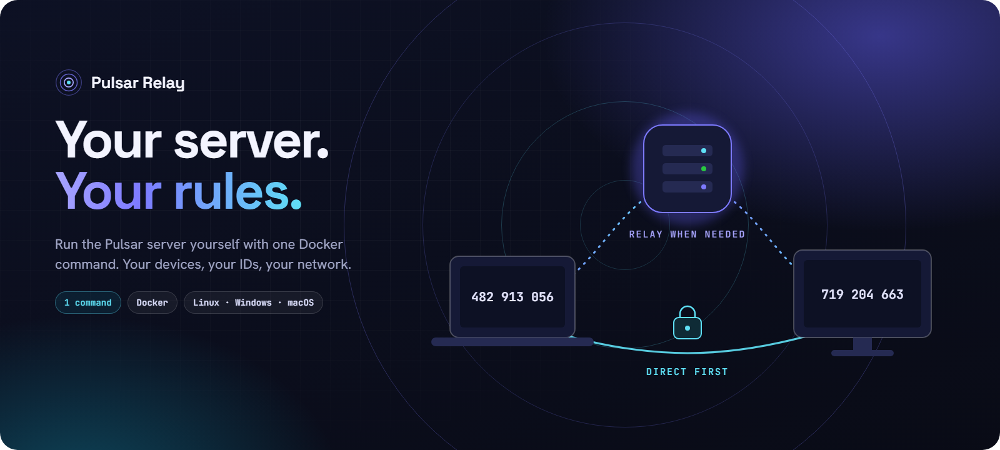

<p align="center">
  <a href="https://pulsardesk.com"></a>
</p>

<h3 align="center">Run your own Pulsar server in one command.</h3>

<p align="center">
  Pulsar works out of the box with the public server. Run this one when you want <b>everything on your own side</b>:<br>
  your own device IDs, your own connection helper, your own fallback when a direct link isn't possible.
</p>

<p align="center">
  <a href="#-start-in-one-minute"></a>
  <a href="https://github.com/PulsarDesk/relay/releases/latest"></a>
</p>

<p align="center">
  <a href="https://github.com/PulsarDesk/relay/releases"></a>
  <a href="https://github.com/PulsarDesk/relay/actions/workflows/ci.yml"></a>
  <a href="https://github.com/PulsarDesk/relay/stargazers"></a>
  <a href="LICENSE"></a>
</p>

## 🛰️ What does it do?

<table>
<tr>
<td width="33%" valign="top">

### 🪪 Hands out IDs
Every device that connects gets its 9-digit Pulsar ID from your server.

</td>
<td width="33%" valign="top">

### 🤝 Introduces devices
It helps two devices find each other, so they can talk **directly**, without anything in the middle.

</td>
<td width="33%" valign="top">

### 🔁 Steps in when needed
When a direct link isn't possible, it passes the traffic along. It can't read it: sessions are end-to-end
encrypted.

</td>
</tr>
</table>

Think of it as a self-hosted RustDesk server, but for Pulsar. It's tiny: a single program, very little CPU and
memory, and one UDP port.

## ⚡ Start in one minute

**1. Run it** with Docker (easiest):

```bash
docker run -d --name pulsar-relay --restart unless-stopped -p 21116:21116/udp ghcr.io/pulsardesk/relay
```

Or download `pulsar-relay` for your system from the [latest release](https://github.com/PulsarDesk/relay/releases/latest)
(Linux x64 / arm64, Windows x64, macOS) and start it. No server at all? The
[Android app](https://github.com/PulsarDesk/pulsar-mobile) can run a relay for your Wi-Fi (Settings).

**2. Open UDP port 21116** on your firewall.

**3. Point Pulsar at it:** on every device, Settings → Network → relay `your-server:21116`.

Done. Your devices now get their IDs from your server.

## 🔐 Lock it down (optional)

A relay is open by default. Add a password, a two-factor (TOTP) code, or both, and require end-to-end encryption:

```bash
pulsar-relay --auth-password s3cret                 # password
pulsar-relay --auth-totp JBSWY3DPEHPK3PXP           # 2FA code (base32 secret)
pulsar-relay --require-e2e                          # only accept encrypted sessions
```

Enrolling 2FA prints a QR code to scan with your authenticator app. Bandwidth limits and every other option:
`pulsar-relay --help` and [docs/self-hosting.md](docs/self-hosting.md).

## 🧪 Where it has been tested

| Where | Status |
|---|---|
| Linux x64, Docker | ✅ runs the public relay |
| Android (inside the app) | ✅ |
| Linux arm64, Windows, macOS binaries | ❔ built on every release, not tested |

Pulsar is in **alpha** (0.x).

## 🐞 Reporting a bug

[Open an issue](https://github.com/PulsarDesk/relay/issues/new/choose) and include:

- Relay version (`pulsar-relay --version`) and how you run it (Docker, binary, phone)
- Your options, **without passwords or 2FA secrets**
- What the app shows when it fails, and the relay's output around that time

## 🌌 The Pulsar family

| | Project | |
|---|---|---|
| 🖥️ | [**Pulsar Desktop**](https://github.com/PulsarDesk/pulsar-desktop) | Pulsar for Windows, macOS and Linux |
| 📱 | [**Pulsar Mobile**](https://github.com/PulsarDesk/pulsar-mobile) | Pulsar for Android phones, tablets and TVs |
| 🧩 | [**pulsar-core**](https://github.com/PulsarDesk/pulsar-core) | The shared engine behind both apps |
| 🌐 | [**pulsardesk.com**](https://pulsardesk.com) | The website |

## 🛠️ For developers

<details>
<summary>Build from source</summary>

**Needs:** Rust stable.

```bash
git clone https://github.com/PulsarDesk/relay.git
cd relay
cargo run --release
cargo test
```

</details>

Everyone is welcome to open [issues](https://github.com/PulsarDesk/relay/issues) and pull requests. Irrelevant or
abusive issues may be closed or removed. Commits follow [Conventional Commits](https://www.conventionalcommits.org).

## 📄 License

Pulsar is free software under the **GNU GPLv3 or later** (GPL-3.0-or-later). See [LICENSE](LICENSE).

<p align="center">
  <br>
  <b>Like Pulsar? A ⭐ helps other people find it.</b>
</p>
